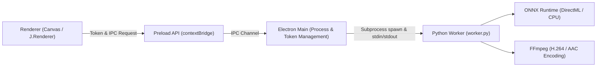

# lyricfx.JIZURA Desktop (Electron Edition) 実装・運用ドキュメント

## 1. 概要とアーキテクチャ

lyricfx.JIZURA Desktop は、Web版の高度な Canvas 描画演出・人物マスク形式をそのまま保ちつつ、ローカル環境の GPU および FFmpeg / Python ネイティブ処理を統合したデスクトップアプリケーションです。



### 責務の分離
- **Renderer**: 画面UI、プレビュー、タイムライン編集、Canvas演出描画（既存 `J.Renderer`）。Node.js やファイルシステム直接アクセス権限は持たない。
- **Preload API**: `contextBridge` による安全な限定通信。Plain Object / ArrayBuffer のみ許容。
- **Electron Main**: ウィンドウ管理、OSネイティブダイアログ（ファイル選択・保存先）、トークン（`assetToken`, `outputToken`）解決、子プロセス寿命管理、一時ファイルのクリーンアップ。
- **Python Worker (`native/worker.py`)**:
  - `probe`: 利用可能デバイス（GPU/CPU、FFmpegエンコーダ）の検出
  - `matte`: RVM MobileNetV3 ONNX による連続人物切り抜き・JIZMAT01 コンテナ生成
  - `export`: stdin からの rawvideo (RGBA) 受信と FFmpeg へのパイプストリーミング、音声多重化

---

## 2. コマンド体系

### Web版のビルド（既定）
```bash
python build.py
```
- 既存のシングルファイルHTML（`index.html`, `en/index.html`）を生成します。

### Electron向けアセットの生成
```bash
python build.py --target electron --out desktop/web
```
- JS / CSS を外部ファイル（`app.css`, `app.ja.js`, `app.en.js`, `vendor/mp4-muxer.min.js`）として分離し、`desktop/renderer/native-backend.js` を組み込んだデスクトップ用HTMLを生成します。

### デスクトップ版の実行（開発時）
```bash
cd desktop
npm install
npm start
```
または、`desktop/start.bat` をダブルクリックしてワンクリック起動できます（初回起動時は自動で `npm install` も実行されます）。

### パッケージング・配布用バイナリ生成
```bash
cd desktop
npm run package   # 展開版ディレクトリの作成（desktop/package_and_run.bat でもビルド＆起動可能）
npm run dist      # NSIS インストーラー生成（desktop/build_installer.bat でも生成可能）
```

---

## 3. セキュリティと境界保護

1. **サンドボックスと分離**:
   - `BrowserWindow` は `sandbox: true`, `contextIsolation: true`, `nodeIntegration: false` を強制。
   - レンダラーにはローカルパスや任意コマンド実行権限を渡さず、セッション内でのみ有効な opaque トークン（UUID）を使用。
2. **ナビゲーションと外部リンク**:
   - アプリ内での外部URL遷移は禁止。外部リンク（`https:`）は OS 標準ブラウザで開きます。
3. **CSP (Content-Security-Policy)**:
   - `default-src 'self' data: blob: https:; script-src 'self'; style-src 'self' 'unsafe-inline' https://fonts.googleapis.com; font-src 'self' data: https://fonts.gstatic.com; media-src 'self' blob: data: jizura-asset:;`
   - `eval` や未許可の外部スクリプト実行を禁止。

---

## 4. 人物切り抜きと自動回復 (Matting)

- **モデル**: RVM MobileNetV3 (ONNX, FP32, 長辺512, downsample_ratio=0.5)
- **プロファイルID**: `rvm-mobilenetv3-fp32-p512-r05-v1`
- **保存形式**: JIZMAT01 コンテナ（v2形式、白RGB + 人物アルファ）。Web版と完全な相互読み込みが可能。
- **GPU・CPUフォールバック**:
  - Windows では `DirectML` (DmlExecutionProvider) によるGPU推論を最優先で試行。
  - GPU利用不可またはOOM時は、同一プロファイルの `CPUExecutionProvider` へ自動切り替えして処理を継続します。

---

## 5. 動画出力 (Export)

- **ストリーミングパイプライン**:
  - レンダラー側で1フレームずつ Canvas から RGBA rawvideo を読み出し、有界キュー（1〜2フレームのバックプレッシャー）で Main 経由で Python/FFmpeg へ流し込みます。
  - メモリ枯渇（OOM）を防ぎ、4Kなどの高解像度出力にも対応。
- **音声多重化**:
  - プロジェクト設定に従い、プロジェクト音声から無音補完・レンジ切り出しを行った WAV を生成し、FFmpeg 側で AAC/48kHz に多重化。
- **エンコーダ選択**:
  - ハードウェアエンコーダ（NVENC, QSV, AMF）および CPU（libx264）に対応。

---

## 6. テストスイート

| テストスクリプト | 目的 |
| - | - |
| `dev/platform_web_test.cjs` | Web版ビルドにおける Node/Electron 依存リークなし・非退行の検証 |
| `dev/desktop_build_test.py` | Electronビルドの分離成果物・外部JS/CSS・CSP設定の検証 |
| `desktop/test/native_dialog.test.cjs` | ネイティブ素材選択・トークン登録・MIME補完の検証 |
| `desktop/test/ipc_security.test.cjs` | トークン検証・パストラバーサル拒否・フレーム長整合性検証 |
| `native/tests/test_matte_format.py` | JIZMAT01 バイナリコンテナの読書き単体テスト |
| `dev/native_matte_compat_test.cjs` | Python生成JIZMAT01をJS側パーサーで読み込む相互運用性検証 |
| `native/tests/test_matting_slots.py` | 疎スロット・非連続スロット・再帰状態リセットの検証 |
| `native/tests/test_job_recovery.py` | GPU非対応・エラー時のCPU自動フォールバック検証 |
