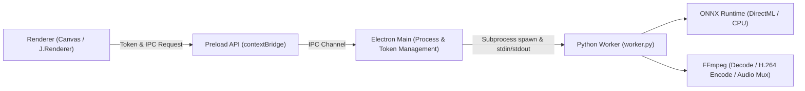

# lyricfx.JIZURA Desktop (Electron Edition) 実装・運用ドキュメント

## 1. 概要とアーキテクチャ

lyricfx.JIZURA Desktop は、Web版の高度な Canvas 描画演出・人物マスク形式をそのまま保ちつつ、ローカル環境の GPU および FFmpeg / Python ネイティブ処理を統合したデスクトップアプリケーションです。



### 責務の分離
- **Renderer**: 画面UI、プレビュー、タイムライン編集、Canvas演出描画（既存 `J.Renderer`）。Node.js やファイルシステム直接アクセス権限は持たない。
- **Preload API**: `contextBridge` による用途別の通信。ファイルはBlob / ArrayBufferから有界のチャンクへ分けて転送する。
- **Electron Main**: ウィンドウ管理、OSネイティブダイアログ（ファイル選択・保存先）、トークン（`assetToken`, `outputToken`）解決、子プロセス寿命管理、一時ファイルのクリーンアップ。
- **Python Worker (`native/worker.py`)**:
  - `probe`: 利用可能デバイス（GPU/CPU、FFmpegエンコーダ）の検出
  - `matte`: RVM MobileNetV3 ONNX による連続人物切り抜き・JIZMAT01 コンテナ生成
  - `export`: stdin からの rawvideo (RGBA) 受信と FFmpeg へのパイプストリーミング、音声多重化
  - `export-session`: 素材の連続デコード、PTSによるフレーム選択、RGBAのエンコード、音声多重化

---

## 2. コマンド体系

### Web版のビルド（既定）
```bash
python build.py
```
- 既存のシングルファイルHTML（`index.html`, `en/index.html`）を生成します。

### Electron向けアセットの生成
```bash
python build.py --target electron --out desktop/web
```
- JS / CSS を外部ファイル（`app.css`, `app.ja.js`, `app.en.js`, `vendor/mp4-muxer.min.js`）として分離し、`desktop/renderer/native-backend.js` を組み込んだデスクトップ用HTMLを生成します。

### デスクトップ版の実行（開発時）
```bash
cd desktop
npm install
npm start
```
または、`desktop/start.bat` をダブルクリックしてワンクリック起動できます（初回起動時は自動で `npm install` も実行されます）。

### パッケージング・配布用バイナリ生成
```bash
cd desktop
npm run package   # 展開版ディレクトリの作成（desktop/package_and_run.bat でもビルド＆起動可能）
npm run dist      # NSIS インストーラー生成（desktop/build_installer.bat でも生成可能）
```

---

## 3. セキュリティと境界保護

素材を元ファイルから独立させる複製処理は、Desktopでは `J.platform.mediaSnapshotChunkBytes` により32MiB単位、Webでは4MiB単位で読み込む。プロジェクト保存とネイティブ素材登録は共通の8MiBチャンク読み込みを使い、現在と次のチャンクだけを保持する。書き込みは確認応答を待って順番に進め、先読み中の読み出しエラーや短いチャンクも成功扱いにしない。

プロジェクト保存は保存先の隣に一時ファイルを作り、サイズを確認してから既存ファイルと置き換える。キャンセルとウィンドウ終了では未完了の書き込みを回収し、既存の保存先を維持する。
ファイル選択の結果は、呼び出し元ウィンドウが生存している場合だけ採用する。ウィンドウ終了後の応答から新しい保存や素材登録を開始しない。

1. **サンドボックスと分離**:
   - `BrowserWindow` は `sandbox: true`, `contextIsolation: true`, `nodeIntegration: false` を強制。
   - レンダラーにはローカルパスや任意コマンド実行権限を渡さず、セッション内でのみ有効な opaque トークン（UUID）を使用。
2. **ナビゲーションと外部リンク**:
   - アプリ内での外部URL遷移は禁止。外部リンク（`https:`）は OS 標準ブラウザで開きます。
3. **CSP (Content-Security-Policy)**:
   - `default-src 'self' data: blob: https:; script-src 'self'; style-src 'self' 'unsafe-inline' https://fonts.googleapis.com; font-src 'self' data: https://fonts.gstatic.com; media-src 'self' blob: data: jizura-asset:;`
   - `eval` や未許可の外部スクリプト実行を禁止。

---

## 4. 人物切り抜きと自動回復 (Matting)

- **モデル**: RVM MobileNetV3 (ONNX, FP32, 長辺512, downsample_ratio=0.5)
- **プロファイルID**: `rvm-mobilenetv3-fp32-p512-r05-v1`
- **保存形式**: JIZMAT01 コンテナ（v2形式、白RGB + 人物アルファ）。Web版と完全な相互読み込みが可能。
- **GPU・CPUフォールバック**:
  - Windows では `DirectML` (DmlExecutionProvider) によるGPU推論を最優先で試行。
  - GPU利用不可またはOOM時は、同一プロファイルの `CPUExecutionProvider` へ自動切り替えして処理を継続します。

PNGから復元した人物マスクの画像は、マスクごとに最大12枚を再利用します。プロジェクト切替時は新プロジェクトの参照を残し、不要なBitmapを閉じます。切替前の読み込みやデコードが後から完了しても、旧キャッシュを再登録しません。

---

## 5. 動画出力 (Export)

### 連続デコードと合成

`J.exportMediaDemand` が出力時刻ごとに背景・前景・トランジション元の素材画像を要求します。背景はすべての演出で供給します。素材の開始位置、ループ周期、トランジションで保持する末尾画像ごとに独立したカーソルを作り、使用区間を連続デコードします。

Python はデコード用FFmpegとエンコード用FFmpegを別々に管理します。入力画像は要求時刻以下で最後のPTSを選び、同じPTSでは画像を再利用します。フレームごとの再シークやデコーダー再起動は行いません。ループで素材時刻が先頭へ戻る場合は次のカーソルへ切り替えます。

素材画像はI420、アルファ付きではI420Aを優先し、その他の画素形式はRGBAで受け渡します。PTS、連番、画素サイズ、表示サイズ、回転、色空間をヘッダーに含めます。Renderer が `VideoFrame` から素材画像を生成し、既存の演出・歌詞・背景・前景を出力の全フレームで合成して、CanvasからRGBAを読み戻します。画素の回転と表示上の縦横比は別々に適用します。

後処理の描画は`J.FXE`の各定義の`draw`に置きます。`scratch`は合成途中のCanvasのコピーが必要な演出に指定します。

### 通信方式と寿命

| `pipeline` | 素材画像と合成済みRGBAの経路 |
| - | - |
| `legacy` | ブラウザの動画シーク → Canvas → contextBridge / IPC → Python |
| `continuous-ipc` | Python → Main → contextBridge / IPC → Canvas → contextBridge / IPC → Main → Python |
| `continuous-port` | Python → Main → MessagePort → Canvas → MessagePort → Main → Python |

`VideoFrame`と連続デコードを利用できる環境では`continuous-port`を既定にします。`continuous-ipc`と`legacy`も比較・互換用に指定できます。

MainとPython間は、ジョブごとのランダムなトークンを持つlocalhost HTTPセッションを使用します。RendererはセッションURLや素材の実パスを受け取りません。MessagePortは出力ジョブだけに結び付けます。ElectronのMessagePortMainではArrayBufferを複製送信し、応答を受け取るまで送信元のバッファを保持します。

デコーダーの画像キューは2枚で、現在画像・次画像・読み取り中の画像を含めて最大5枚を所有します。同時カーソルは最大4、デコード画像の合計予算は256MiBです。上限を超える場合はエラーになります。合成済みRGBAの送信は最大4フレームを同時処理し、Mainが順序を固定します。Pythonはフレーム全体をエンコーダーのパイプへ書き込んでから応答します。使用済みカーソル、閉じたVideoFrame、ジョブのポートとバッファは終了時に解放します。

### 終了、音声、エンコーダー

出力連番・フレーム長・予定枚数を照合し、途中EOF、画像不足、子プロセス異常をエラーにします。終了確認後に一時MP4を保存先へ公開します。キャンセルは準備中のジョブにも届き、WindowsではPython配下のFFmpegも終了します。

書き出し完了後、次のHTTP要求行を待っている接続のリセットは正常な切断として処理します。完了前の切断、要求や応答の処理中の切断、その他のI/O例外は引き続きエラーとして扱います。

音声ファイルを保持している場合は指定区間を多重化し、対応形式では元の音声パケットをコピーします。コピーできない場合はAACへ変換します。音声バッファだけの場合は指定区間からWAVを生成します。

エンコーダーはNVENC、AMF、QSV、libx264に対応します。`auto` はこの順で実際に起動できるエンコーダーを選びます。連続デコードはCPUで行い、合成とエンコードのGPU利用はそれぞれ独立しています。

---

## 6. テストスイート

ブラウザーテストは`dev/test_helpers.cjs`の`launchBrowser`を使います。`JIZURA_TEST_BROWSER`、`CHROMIUM_PATH`、`EDGE_PATH`で実行ファイルを指定でき、プロファイルと一時成果物は`.codex-temp/tests/`へ出力します。`loadApp`は外部サーバーを必要とせず、日英のローカルビルドを読み込みます。`JIZURA_TEST_BUILD_DIR`で比較対象のビルドを切り替えられます。プロジェクトの試験データは`importProject`で`.lyricfx`へ格納して実際の読み込み経路へ渡します。

| テストスクリプト | 目的 |
| - | - |
| `dev/platform_web_test.cjs` | Web版ビルドにおける Node/Electron 依存リークなし・非退行の検証 |
| `dev/desktop_build_test.py` | Electronビルドの分離成果物・外部JS/CSS・CSP設定の検証 |
| `desktop/test/native_dialog.test.cjs` | ネイティブ素材選択・トークン登録・MIME補完の検証 |
| `desktop/test/ipc_security.test.cjs` | トークン検証・パストラバーサル拒否・フレーム長整合性検証 |
| `desktop/test/file_chunks.test.cjs` | ファイル転送の先読み上限・順序・空データ・キャンセル・読み書き異常の検証 |
| `desktop/test/project_save.test.cjs` | プロジェクトの置換・サイズ確認・キャンセル・ウィンドウ終了時の回収の検証 |
| `dev/text_layer_lifecycle_test.cjs` | 文字レイヤーの面積上限と縦横比変更後の画素一致の検証 |
| `dev/fx_renderer_contract_test.cjs` | 後処理のCanvas状態、例外の分離、元画像コピーの契約検証 |
| `dev/glyph_tint_cache_test.cjs` | 着色した文字画像の64MiB上限・退避・再生成・初期化の検証 |
| `dev/media_cache_lifecycle_test.cjs` | 取り消し履歴・共有素材・履歴の期限切れと参照回収の検証 |
| `dev/audio_history_lifecycle_test.cjs` | 音声の履歴期限切れ・共有参照・作業データ保持と分岐破棄の検証 |
| `dev/chroma_pixels_test.cjs` | クロマキーの色相・彩度・アルファと端の黒い余白の固定画素検証 |
| `dev/thermal_pixels_test.cjs` | 熱画像の輝度補間・アルファ・適用量の固定画素検証 |
| `dev/sprite_components_test.cjs` | 素材切り出しの範囲・ラベル・順序の固定ベクトル検証 |
| `dev/sprite_extractor_ui_test.cjs` | 素材切り出しの透明余白・色・登録・取り消しの操作検証 |
| `dev/media_preview_lifecycle_test.cjs` | 非表示レイヤーへのプロジェクト切り替えで旧プレビュー計画を解放する検証 |
| `dev/media_storage_fallback_test.cjs` | 保存領域の失敗・復旧・現素材の保持・不要な一時素材の回収 |
| `dev/cut_detail_lifecycle_test.cjs` | 詳細フォームの再生成・履歴・終了時のCanvas監視の回収 |
| `dev/audio_analysis_test.cjs` | ブロック解析によるPCM・波形・拍・テンポの一致 |
| `dev/audio_wav_test.cjs` | 元音声がない場合のPCM16変換・切り出し・無音・RIFF上限の検証 |
| `dev/lyric_composition_math_test.cjs` | 候補領域の採点変更前後の配置一致 |
| `dev/planner_history_weights_test.cjs` | 両選択モードの履歴の重みをFloat64で比較 |
| `dev/lyric_list_controls_test.cjs` | 歌詞行と選択欄の再利用・入力の復元・定義変更・イベント重複・削除後の回収 |
| `dev/list_playback_highlight_test.cjs` | 素材・回避一覧の再生行、空白区間、タブ切替と一覧再生成の検証 |
| `dev/timeline_links_cache_test.cjs` | タイムラインSVGの再利用、ズーム・リンク・ドラッグ・フォーカス・画面幅変更の検証 |
| `dev/project_load_lifecycle_test.cjs` | 素材と音声の同時復元・失敗時の編集保持・遅延完了・準備済み素材の回収 |
| `native/tests/test_export_session.py` | CFR/VFRのPTS・画素・アルファ・回転・EOF・異常終了の検証 |
| `native/tests/test_export_http_shutdown.py` | 完了後の待機切断だけを処理し、要求処理・フレーム受信・エンコーダーの異常を保持する検証 |
| `desktop/test/export_session.test.cjs` | 素材受信・出力順序・終了枚数・準備中キャンセルの検証 |
| `dev/export_media_plan_test.cjs` | 素材開始位置・ループ・前景・トランジションの要求計画の検証 |
| `native/tests/test_matte_format.py` | JIZMAT01 バイナリコンテナの読書き単体テスト |
| `dev/native_matte_compat_test.cjs` | Python生成JIZMAT01をJS側パーサーで読み込む相互運用性検証 |
| `native/tests/test_matting_slots.py` | 疎スロット・非連続スロット・再帰状態リセットの検証 |
| `native/tests/test_job_recovery.py` | GPU非対応・エラー時のCPU自動フォールバック検証 |
